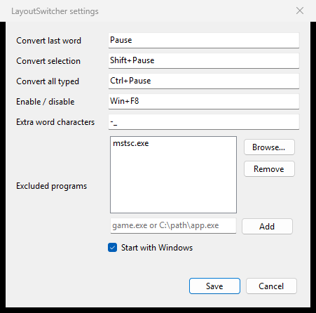

# LayoutSwitcher

Typed `ghbdsn` when you meant `привіт`? Press **Pause**.

LayoutSwitcher is a small Windows tray app and macOS menu bar app that fixes text typed in the wrong keyboard
layout, Ukrainian ↔ English, and switches the layout for you. It runs only when you press a hotkey and never guesses
on its own.


## Features

| Windows | macOS | What it does |
|---|---|---|
| `Pause` | `Ctrl+Option+W` | Converts the **last word** you typed and switches the layout. Press again to undo. |
| `Ctrl+Pause` | `Ctrl+Option+A` | Converts **all text typed** since you last clicked, pressed Enter or changed windows. Press again to undo. |
| `Shift+Pause` | `Ctrl+Option+S` | Converts the **selected text**. Your clipboard is put back afterwards. |
| `Win+F8` | `Ctrl+Option+T` | Turns the app on or off. |

Macs have no Pause key, and `Ctrl+Space` / `Ctrl+Option+Space` already switch input sources there, so the Mac
defaults use `Ctrl+Option` with a letter. All hotkeys can be changed in Settings.

- Keeps capitals and CapsLock: `Ghbdsn` → `Привіт`, `GHBDSN` → `ПРИВІТ`.
- Treats `, . ; ' [ ]` as letters when they are Ukrainian letters (`б ю ж є х ї`), so `ghbdsn,` converts as one word.
- The tray icon shows the current layout: `EN` or `UA`. It is grey when the app is off, and shows `!` in windows where
  it cannot work.
- You can set excluded programs, such as games or remote desktop, where the app does nothing.
- It never logs or stores what you type.



## Install on Windows

1. Download a zip from [Releases](https://github.com/slc1/layout-switcher/releases/latest):
   - `LayoutSwitcher-<version>-win-x64.zip` — tiny; needs the
     [.NET 10 Desktop Runtime](https://dotnet.microsoft.com/download/dotnet/10.0).
   - `LayoutSwitcher-<version>-win-x64-self-contained.zip` — larger; needs nothing else.
2. Unzip anywhere and run `LayoutSwitcher.exe`.

You need Windows 10 or 11 with both the Ukrainian and an English keyboard layout installed.
"Start with Windows" is on by default. Double-click the tray icon to open Settings and change it, or to change hotkeys.

Settings are stored in `%AppData%\LayoutSwitcher\settings.json`. Logging is off by default. To turn it on, set
`"logLevel": "Info"` in that file; the log goes to `%LocalAppData%\LayoutSwitcher\logs`.

## Install on macOS

Build the app from source (see below) and copy `LayoutSwitcher.app` to `/Applications`. You need macOS 13 or
later with the Ukrainian and an English input source (ABC, U.S. or British) in System Settings → Keyboard →
Input Sources.

On first start macOS asks to allow LayoutSwitcher in System Settings → Privacy & Security → **Accessibility**.
Until you do, the menu bar shows `!`; the app starts working as soon as access is granted. A rebuilt, unsigned app
counts as a new app, so remove the old entry from the list and allow it again.

"Start at login" is on by default (a LaunchAgent in `~/Library/LaunchAgents`). Settings are stored in
`~/Library/Application Support/LayoutSwitcher/settings.json`, logs go to `~/Library/Logs/LayoutSwitcher`.
Excluded apps are listed by app name (`Safari.app`), bundle id (`com.apple.Safari`) or full path.

## Limitations

- **Windows running as administrator.** Windows does not let a normal app see or type keys in them, so the app
  shows `!` in the tray instead of converting.
- **Consoles.** `Shift+Pause` is off in console windows, where `Ctrl+C` interrupts the running program.
- **Some apps ignore the way the text is retyped**, such as some games and remote desktop clients. Add them to the
  excluded programs.
- **AltGr characters** (for example `ґ` on the standard Ukrainian layout) cannot be converted.
- **The exe is not code-signed**, so SmartScreen may warn the first time you run it.
- **macOS: password fields and secure input.** While secure input is on, macOS hides keys from every app, so the
  menu bar shows `!` and the hotkeys do nothing.
- **macOS: the app is not notarized.** Open it with right-click → Open the first time.

## Build from source

You need the .NET 10 SDK.

```
dotnet build LayoutSwitcher.slnx
dotnet test tests/LayoutSwitcher.Core.Tests
dotnet run --project src/LayoutSwitcher.App
```

On macOS you also need Xcode and the .NET macOS workload (`dotnet workload install macos`):

```
dotnet build LayoutSwitcher.Mac.slnx
dotnet publish src/LayoutSwitcher.Mac -c Release   # universal LayoutSwitcher.app and a .pkg under bin/Release/net10.0-macos
```

`LayoutSwitcher.app/Contents/MacOS/LayoutSwitcher --self-test report.txt` checks the layout tables on a Mac.

The app also has diagnostic modes:

| Command | What it does |
|---|---|
| `LayoutSwitcher.exe --self-test report.txt` | Builds the layout tables from the installed layouts and converts sample text. No UI, no hooks. |
| `LayoutSwitcher.exe --e2e report.txt` | Opens a test window and drives the real hook, typing and clipboard in it (~10 s). Do not type meanwhile, keep CapsLock off, and do not run it while the tray app is running. It stops at once if the window loses focus. |
| `LayoutSwitcher.exe --docs-images docs/images` | Regenerates the images in this README. |

## How it works

- A low-level keyboard hook records the **keys** you press, not the characters.
- On a hotkey, the app erases what you typed and types the same keys as they would come out in the other layout.
  Then it switches the layout of the window you are typing in.
- Selected text goes through the clipboard: copy, convert, paste, then restore what was there before.

The project has three parts:

- **`src/LayoutSwitcher.Core`** is pure logic with no OS calls, covered by unit tests: layout tables, word
  boundaries, the typed-key buffer, conversion and undo, hotkeys and settings.
- **`src/LayoutSwitcher.App`** is a thin WinForms and Win32 layer: hooks, `SendInput`, layout switching,
  clipboard, tray and settings.
- **`src/LayoutSwitcher.Mac`** is the same layer for macOS on AppKit: a Quartz event tap, `CGEventPost`, Text
  Input Sources, `NSPasteboard`, the menu bar item and settings.

More detail is in [`docs/design.md`](docs/design.md).

## Acknowledgements

Inspired by [SimpleSwitcher](https://github.com/Aegel5/SimpleSwitcher). LayoutSwitcher is a separate implementation
with a smaller scope.
